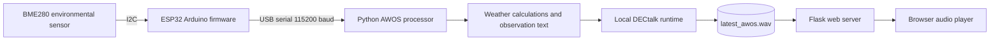

# System architecture



## Firmware / Python contract

The ESP32 reads the BME280 once per second. Each observation is emitted in the serial format:

```text
Temp: 24.31 C  Hum: 63.4 %  Pres: 1012.8 hPa
```

`awos_weather.py` parses the three fields and computes:

- Dew point using a Magnus-formula approximation.
- Station-pressure correction to an altimeter setting using configured station elevation.
- Pressure altitude and density altitude approximations.
- A **humidity/dewpoint-spread visibility estimate**. This is a heuristic, not a measurement from a visibility sensor.
- Number-by-number spoken observation text, using `niner` for 9 and UTC/Zulu time.

`awos_live.py` consumes the USB serial feed continuously and generates a refreshed WAV once per UTC minute. A Windows DECtalk DLL generates the speech file locally; the file is replaced after rendering to prevent the web player from receiving a partially written recording.

`awos_server.py` serves a small browser UI and provides `/awos.wav` with cache control disabled so pressing **Listen to Current AWOS** fetches the newest recording.

## Software components

| File | Responsibility |
| --- | --- |
| `firmware/awos/awos.ino` | ESP32 BME280 sampling and serial output |
| `awos_weather.py` | Parsing, weather math and spoken observation formatting |
| `awos_live.py` | Serial acquisition and Windows DECtalk WAV generation |
| `awos_server.py` | Flask audio page and WAV endpoint |
| `tests/test_weather.py` | Offline checks of parsing, math and phrase generation |

Wind and sky-condition fields are intentionally announced as unavailable in the standard format, since no anemometer or cloud sensor is connected. The extended format reproduces an earlier observation script containing experimental pressure-altitude and visibility remarks.
